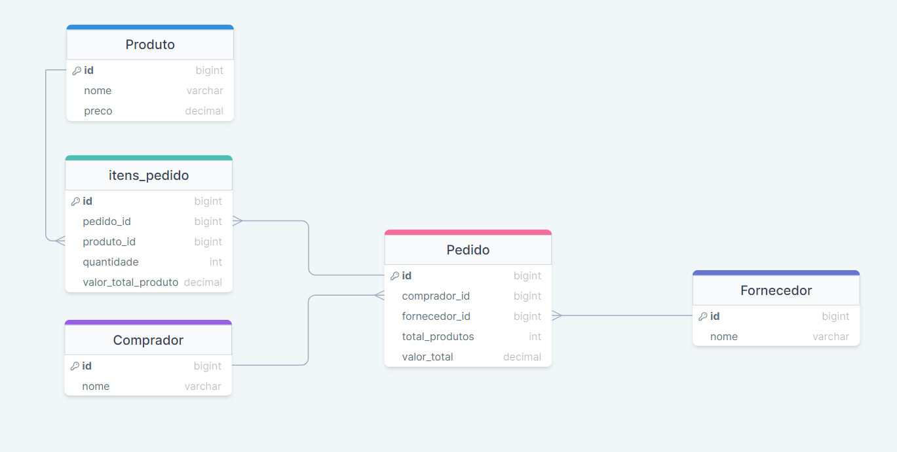

# Pedidos — Order Management

**English** | [Português](#português)

Full stack order management application: a **Spring Boot REST API** with MySQL and an **Angular 16 + Angular Material** front-end that lists orders and shows the items of each order in a modal.

## Features

- List orders with buyer, supplier, number of products and total value
- View the items of an order (products and quantities) in a modal
- Relational model with orders, order items, products, buyers and suppliers
- API documentation with Swagger UI

## Tech stack

| Layer | Technologies |
|---|---|
| Back-end | Java 21, Spring Boot, Spring Data JPA, Bean Validation, ModelMapper, Lombok, springdoc-openapi |
| Front-end | Angular 16, Angular Material, TypeScript, RxJS |
| Database | MySQL |

## Project structure

```
pedidos-api/                 Spring Boot REST API
pedidos-app/                 Angular front-end
Criando Base e Tabelas.sql   Database and tables
Alimentando Tabelas.sql      Initial data
Diagrama.png                 Database diagram
```



## API endpoints

| Method | Path | Description |
|---|---|---|
| GET | `/api/pedido` | List orders |
| GET | `/api/pedido/itens/{id}` | List the items of an order |

## Running locally

**Requirements:** Java 21, Node.js, Angular CLI and MySQL.

1. Run `Criando Base e Tabelas.sql` and then `Alimentando Tabelas.sql` on MySQL.
2. Start the API, setting the database credentials as environment variables:
   ```bash
   cd pedidos-api
   DB_USER=your_user DB_PASSWORD=your_password ./mvnw spring-boot:run
   ```
3. Start the front-end:
   ```bash
   cd pedidos-app
   npm install
   npm start
   ```

| | URL |
|---|---|
| API | http://localhost:8080 |
| Swagger UI | http://localhost:8080/swagger-ui/index.html |
| Front-end | http://localhost:4200 |

---

## Português

Aplicação full stack de gestão de pedidos: uma **API REST em Spring Boot** com MySQL e um front-end em **Angular 16 com Angular Material**, que lista os pedidos e exibe os itens de cada pedido em um modal.

### Funcionalidades

- Listagem de pedidos com comprador, fornecedor, quantidade de produtos e valor total
- Consulta dos itens de um pedido (produtos e quantidades) em um modal
- Modelo relacional com pedidos, itens, produtos, compradores e fornecedores
- Documentação da API com Swagger UI

### Tecnologias

- **Back-end:** Java 21, Spring Boot, Spring Data JPA, Bean Validation, ModelMapper, Lombok, springdoc-openapi
- **Front-end:** Angular 16, Angular Material, TypeScript, RxJS
- **Banco de dados:** MySQL

### Como executar

Requisitos: Java 21, Node.js, Angular CLI e MySQL.

1. Execute no MySQL o script `Criando Base e Tabelas.sql` e depois `Alimentando Tabelas.sql`.
2. Inicie a API informando as credenciais do banco por variáveis de ambiente:
   ```bash
   cd pedidos-api
   DB_USER=seu_usuario DB_PASSWORD=sua_senha ./mvnw spring-boot:run
   ```
3. Inicie o front-end:
   ```bash
   cd pedidos-app
   npm install
   npm start
   ```

API em `http://localhost:8080`, Swagger em `http://localhost:8080/swagger-ui/index.html` e front-end em `http://localhost:4200`.
